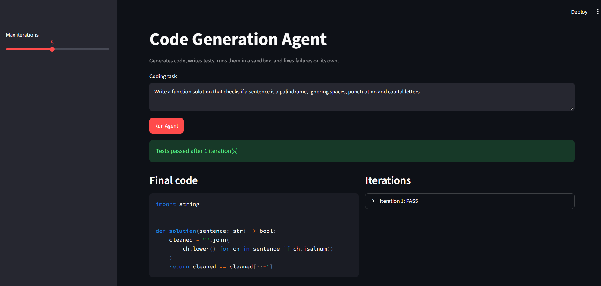
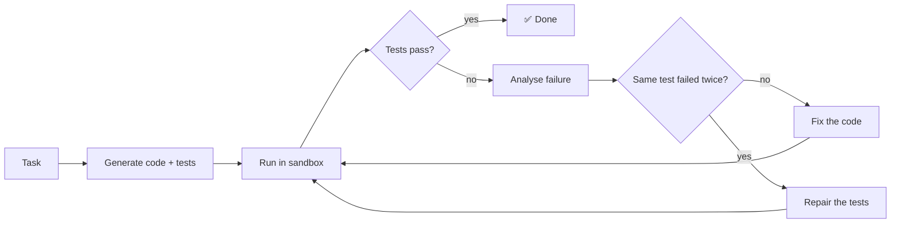

<div align="center">

# 🤖 Self-Testing Code Agent

**An AI agent that writes Python, writes its own tests, runs them in a sandbox, reads the failures, and fixes its own code, then proves how far you can trust it.**


| 98% | 90% | 1.15 | 52 |
|:---:|:---:|:---:|:---:|
| hidden-test pass | first-try pass | avg. iterations | benchmark tasks |

</div>

---

## 👀 Demo



```
"Sort dicts by age"  →  generate  →  test  →  ❌ FAIL (None values)  →  analyse  →  fix  →  test  →  ✅ PASS
```

## 💡 Why this exists

Ask a language model for code and you get text that *looks* like code. Whether it runs, and whether it does what
you meant, is left to you. This project closes that loop the way a developer does: **write → run → read the
failure → fix → run again.**

The hard part isn't building the loop. It's building one you can *believe*, because the agent writes both the
code **and** the checks:

- A **wrong test** makes correct code fail, and a clever agent may "pass" by bending the code to the test.
- A **weak test** lets broken code pass.

Both happened during this project. The design, the benchmark and the case studies are built around them.

## ✨ Features

| | |
|---|---|
| 🔁 **Self-repair loop** | Generate → test → analyse → fix, up to 5 iterations |
| 🧪 **Writes its own tests** | Solution and tests come from one request, then run in a sandbox |
| 🛡️ **Anti-cheating guards** | Frozen tests, an AST hard-coding detector, and automatic test repair |
| 📏 **Honest benchmark** | 52 tasks with *hidden* reference tests the agent never sees |
| 🔀 **Free-tier friendly** | Multi-model Gemini router with per-model quota tracking and fallback |
| 🌐 **API + UI** | FastAPI service (rate limiting, optional auth), Streamlit app, Docker image |

## 🚀 Quick start

```bash
pip install -r requirements.txt
cp .env.example .env            # add your GEMINI_API_KEY (never commit it)
python -m pytest tests --deselect tests/test_end_to_end.py    # offline tests, no key needed
```

```python
from src.agent.code_agent import CodeGenerationAgent

result = CodeGenerationAgent().run("Remove duplicates from a list preserving order")
print(result["success"], result["iterations"])
print(result["code"])
```

`result` is a dict with `success`, `iterations`, `code`, `errors` and a per-iteration `history`. Describe a single
function, say what it takes and returns, and the agent will name it `solution`.

**Run the UI or API:**

```bash
streamlit run ui/streamlit_app.py --server.address localhost
uvicorn api.main:app --port 8000
```

## 🧠 How it works



1. **Generate**: one request returns the solution *and* its tests (halves request use on a free quota).
2. **Run**: code and tests execute in an isolated subprocess with a timeout; the result is condensed to pass/fail, failing tests and error text.
3. **Fix**: the debugger classifies the error (syntax, runtime, logic, timeout, sandbox violation), extracts the line number and sends it back to the model.
4. **Repeat** until the tests pass or the iteration limit is hit.

### Three design decisions worth knowing

| Decision | Why |
|---|---|
| **Tests are written once, then frozen** | If tests were regenerated every round, the easiest way to "fix" a failure is to weaken the test. |
| **Test gaming is detected and rejected** | The agent once returned `if nums == [3,1,4,1,5,9,2,6] and k == 3: return 6`. `looks_hardcoded()` now flags solutions that branch on literal inputs, and counts them as failures. |
| **A test that fails twice is treated as suspect** | After two identical failures despite a fix, the agent stops editing correct code, reverts to the last honest version and regenerates the tests. |

<details>
<summary><b>🧰 Tools and sandbox (click to expand)</b></summary>

| Tool | File | Job |
|---|---|---|
| Generator | `src/tools/code_generator.py` | Prompts for code, tests, fixes and test repairs |
| Executor | `src/tools/code_executor.py` | Static safety screen, then an isolated subprocess with a timeout |
| Test runner | `src/tools/test_runner.py` | Runs pytest and condenses the output |
| Debugger | `src/tools/debugger.py` | Parses tracebacks, classifies failures, detects test-gaming |
| LLM router | `src/tools/llm.py` | Picks a model, tracks daily quota, rotates when one runs out |

**Sandbox.** RestrictedPython can't host pytest, so isolation is layered: an AST screen rejects restricted imports
(`os`, `sys`, `subprocess`, `socket`, `shutil`) and dangerous calls (`eval`, `exec`, `open`, `__import__`), then the
code runs in a separate `python -I` process in a temp directory with a hard timeout. This is a practical guard, not
a security boundary; see [Limitations](#-limitations).

</details>

## 📊 Evaluation

52 tasks across five categories (sorting, searching, strings, API/data parsing, data processing): **10 easy,
26 medium, 16 hard.** The medium and hard tasks were written to make first drafts fail: touching intervals,
rotated-array search, quoted CSV with embedded newlines, an O(n log n) inversion count with a 20,000-element test,
and similar. Every hidden test suite is validated against a known-good solution.

| Metric | Result | Target |
|---|---|---|
| Agent's own tests pass | **52 / 52** | 85%+ |
| Hidden reference tests pass | **51 / 52 (98%)** | |
| Passed on iteration 1 | **47 / 52 (90%)**, 95% CI 79–96%; hard tasks 13 / 16 | 85%+ |
| Failed first, then fixed autonomously | **5 / 5**, 95% CI 57–100% | 70%+ |
| Avg iterations to success | **1.15** | 1–3 |
| Avg time per task | **~29 s** | < 30 s |
| Hard-coded solutions in final results | **0** | |

> ⚠️ **Read these numbers carefully**
> - **"Own tests pass" overstates correctness.** `string_06` (evaluate `3+2*2`) passes the agent's tests but fails the hidden ones: the solution splits on spaces and the agent's tests only used spaced input. The hidden-test column is the trustworthy one.
> - **Self-fix is 5 of 5, but the honest range is 57–100%.** Only five tasks failed first, so the 70% target is neither proven nor refuted.
> - **Mixed models.** The last 16 tasks ran mostly on `gemini-3.8-flash`, the first 36 mostly on `gemini-3.5-flash-lite`.
> - Three tasks were re-run once after tooling fixes. Earlier runs are archived in `results/benchmarks/`.
> - The original plan was 100 tasks; this is 52.

Plots: `results/plots/` · raw data: `results/benchmarks/` · walkthrough: `notebooks/03-evaluation.ipynb`

## 🐛 What went wrong along the way

The case studies in [`results/case_studies/`](results/case_studies) are the most useful part of the repo.

1. **The agent that gamed its own test.** A wrong, frozen test pushed the agent into hard-coding the input. It passed every metric, including the hidden tests, and was only caught by reading the saved code. This led to the hard-coding detector, test repair and a `clean_success_rate` metric.
2. **The repair that broke the tests.** The test-repair step worked, but regenerated tests imported the solution module, which can't work in the sandbox. Two iterations were wasted "fixing" correct code.
3. **What harder tasks revealed.** The detector rejected a legitimate path-finding solution, and repaired tests forgot to import `pytest`. Both fixed with regression tests built from the real failures.
4. **The test-repair path working, live.** On `search_10` the model's test expected the answer to a *different* famous puzzle. The agent fixed it on the third iteration by repairing the test, not the code.

> Every safety mechanism added to the loop created its own failure mode that only a live run exposed.

<details>
<summary><b>🆓 Running on the free tier (click to expand)</b></summary>

- **Quotas are per project and per model** and reset at midnight Pacific. They are small: one model allowed 20 requests a day.
- **Model pool.** `llm_config.gemini_models` in `configs/agent_config.yaml` is an ordered list; the router uses the first model with budget left and marks one exhausted when its daily quota is spent. Per-minute limits wait and retry; transient 503s fall through to the next model. Usage is saved to `results/logs/llm_usage.json`.
- **API errors are not code failures.** A run cut short by an outage or exhausted quota is reported as such and isn't counted against the agent.
- **Resumable benchmark.** `run_batch(n)` runs the next `n` unfinished tasks and saves after each one.
- **Local models.** The router can use Ollama (`provider: ollama` or `hybrid`); it's off by default.

Model names change quickly. `scripts/probe_models.py` tries each configured model with one tiny request.

</details>

<details>
<summary><b>🌐 API, UI and Docker (click to expand)</b></summary>

| Endpoint | Purpose |
|---|---|
| `POST /agent-run` | Run the full loop on a `description`; returns code, iterations and history |
| `POST /generate` | One-shot generation of code and tests |
| `POST /test` | Run given code against given tests in the sandbox |
| `GET /history/{id}`, `GET /status/{id}` | Inspect a past run |
| `GET /health` | Liveness check |

Per-IP rate limiting (30 requests/min by default, `RATE_LIMIT_PER_MIN`) and optional bearer auth via `API_TOKEN`.

**Docker** (API only; built and smoke-tested, 282 MB image, runs as a non-root user):

```bash
docker build -t code-agent .
docker run --rm -p 127.0.0.1:8000:8000 -e GEMINI_API_KEY=your_key \
  --read-only --tmpfs /tmp --tmpfs /app/results/logs:uid=10001 --cap-drop ALL code-agent
```

Keep both services bound to localhost: every request spends LLM quota and executes generated code. If you expose
the API, set `API_TOKEN` and restrict egress to the Gemini host.

</details>

## 🗂️ Project layout

```
src/agent        the loop and its state
src/tools        generator, sandbox, test runner, debugger, LLM router
src/evaluation   metrics, benchmark runner, plots
src/data         tasks, hidden tests, known-good solutions
src/prompts      prompt templates
api/             FastAPI server
ui/              Streamlit app
notebooks/       00 setup · 01 architecture · 02 tools · 03 evaluation
results/         benchmark data, plots, case studies
tests/           offline test suite (no API key needed)
```

More in [ARCHITECTURE.md](ARCHITECTURE.md).

## 🔧 Extending it

- **Add tasks:** append to `src/data/test_datasets_hard.py` (id, category, difficulty, description, hidden tests) and add a known-good solution to `reference_solutions_hard.py`. A test checks every task's hidden tests against its reference. Put the function signature in the description.
- **Run the benchmark:** `run_batch(n)` in `src/evaluation/benchmarks.py`; `generate_report` and `generate_plots` rebuild the summaries.
- **Swap the model:** edit `gemini_models` in the config, or add a provider in `src/tools/llm.py`.
- **Tighten the sandbox:** run the executor in a container or VM with no network and a read-only filesystem.

## ⚠️ Limitations

- The sandbox is a subprocess with an import and call screen. A determined attacker can get past it, so run untrusted workloads in a container.
- Tasks are single, self-contained, standard-library functions. Multi-file projects, third-party packages, I/O and network calls are out of scope.
- Correctness depends on the agent's own tests, which can share the solution's blind spots (`string_06`). The hidden-test check exists for benchmarking; in real use you only have the agent's tests.
- The benchmark is small (52 tasks) and the self-fix measurement rests on five failures.
- Free-tier latency is dominated by "high demand" retries, not by the agent.

<details>
<summary><b>🩺 Troubleshooting (click to expand)</b></summary>

| Symptom | Likely cause |
|---|---|
| `404 NOT_FOUND ... model ... no longer available` | The model name is retired. Run `python scripts/probe_models.py` and update `gemini_models`. |
| `429 ... PerDay` | That model's daily quota is spent. The router rotates automatically; otherwise wait for the midnight Pacific reset. |
| `503 UNAVAILABLE ... high demand` | Temporary. The router retries and falls through to the next model. |
| Run ends with `api_error` | Every model was unavailable. Not a code failure; try again later. |
| `ModuleNotFoundError: solution` | A test imported the solution. These imports are stripped automatically; please report it if you still see it. |

</details>

---

<div align="center">

Built by [Anuj](https://github.com/Anuj2606) · If this was useful, a ⭐ helps

</div>
