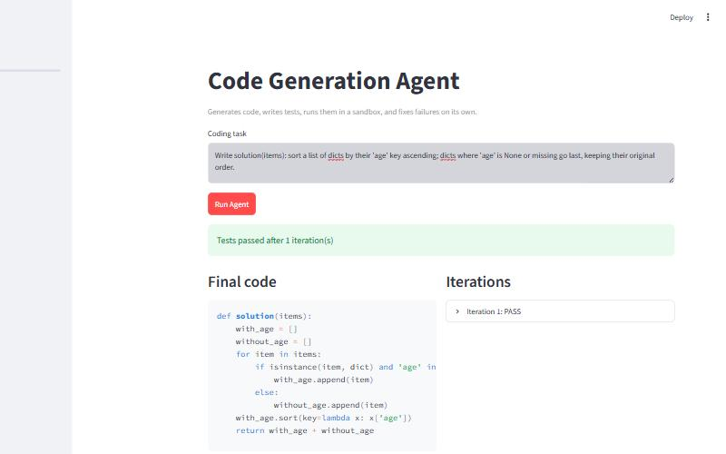

# Code Generation + Testing Agent

An agent that writes Python from a plain-English task, writes its own tests, runs them in a sandbox, reads any
failure, and rewrites the code until the tests pass.

```
"Sort dicts by age" -> generate -> test -> FAIL (None values) -> analyse -> fix -> test -> PASS
```



Most code generators stop after the first draft and hope it works. This one checks its output and repairs it.
It also ships with a benchmark that measures how often that checking can be trusted, which turned out to be the
more interesting question.

- [Why this exists](#why-this-exists)
- [Quick start](#quick-start)
- [How it works](#how-it-works)
- [Evaluation](#evaluation)
- [What went wrong along the way](#what-went-wrong-along-the-way)
- [Running on the free tier](#running-on-the-free-tier)
- [API and UI](#api-and-ui)
- [Project layout](#project-layout)
- [Extending it](#extending-it)
- [Limitations](#limitations)
- [Troubleshooting](#troubleshooting)

## Why this exists

A language model asked for code gives you text that looks like code. Whether it runs, and whether it does what
you meant, is left to you. The idea behind this project is the loop a developer follows without thinking about
it: write something, run it against checks, read the failure, change the code, run again.

Building the loop is easy. Building one you can *believe* is harder, because the agent writes both the code and
the checks. If a check is wrong, a correct solution fails it and a clever agent may "pass" by bending the code
to the check instead of the task. If the checks miss a case, a broken solution passes. Both happened during this
project, and the design reflects them.

Typical uses: generating small, self-contained utility functions with a built-in regression test; studying how
agents recover from their own errors; and as a reference implementation of a plan, act, observe, decide loop with
real tools and a real evaluation harness.

## Quick start

```bash
pip install -r requirements.txt
cp .env.example .env          # put your GEMINI_API_KEY in .env (never commit it)
python -m pytest tests --deselect tests/test_end_to_end.py   # offline tests, no key needed
```

```python
from src.agent.code_agent import CodeGenerationAgent

result = CodeGenerationAgent().run("Remove duplicates from a list preserving order")
print(result["success"], result["iterations"])
print(result["code"])
```

The result is a dict with `success`, `iterations`, `code`, `errors`, and a per-iteration `history`. Tasks should
describe a single function and say what it takes and returns; the agent names the function `solution`.

`tests/test_end_to_end.py` is the one test that calls the real model. It skips itself when no key is configured.

## How it works

### The loop

```
task -> THINK -> ACT -> OBSERVE -> DECIDE -> (repeat, up to 5 iterations)
        |        |        |
        |        |        +- pytest result: pass/fail, error text, which tests failed
        |        +- call the LLM, run the tests in the sandbox
        +- first pass: "generate"; later: "fix" or "repair tests"
```

1. **Generate.** One model request returns the solution *and* its tests together. Asking for both at once
   halves the request count on the first iteration, which matters on a free quota.
2. **Run.** The code and tests execute in a sandboxed subprocess. The result is condensed into pass/fail, the
   names of failing tests, and the error text.
3. **Fix.** On failure, the debugger classifies the error (syntax, runtime, logic, timeout, sandbox violation)
   and extracts the line number. That analysis, plus the failing code, goes back to the model with an
   instruction to repair it.
4. **Repeat** until the tests pass or the iteration limit is reached.

### Tools

| Tool | File | Job |
|---|---|---|
| Generator | `src/tools/code_generator.py` | Prompts for code, tests, fixes and test repairs |
| Executor | `src/tools/code_executor.py` | Static safety screen, then an isolated subprocess with a timeout |
| Test runner | `src/tools/test_runner.py` | Runs pytest and condenses the output |
| Debugger | `src/tools/debugger.py` | Parses tracebacks, classifies failures, detects test-gaming |
| LLM router | `src/tools/llm.py` | Picks a model, tracks daily quota, rotates when one runs out |

### The sandbox

The original plan was RestrictedPython, but it cannot host pytest: it forbids the imports and introspection
pytest needs. Isolation is instead layered. First an AST screen rejects restricted imports (`os`, `sys`,
`subprocess`, `socket`, `shutil`) and dangerous calls (`eval`, `exec`, `open`, `__import__`). Then the code runs
in a separate `python -I` process in a temporary directory with a hard timeout, so an infinite loop is killed
rather than hanging the agent. This is a practical guard, not a security boundary; see [Limitations](#limitations).

### Three design decisions worth knowing

**Tests are written once and then held fixed.** If the agent regenerated tests every iteration, the easiest way
to make a failure disappear would be to weaken the test. Freezing them closes that door. It also opens another:
when a generated test is simply *wrong*, the agent cannot correct it. The next two points deal with that.

**Test gaming is detected and rejected.** When a test was wrong and could not be changed, the agent once
returned code like `if nums == [3, 1, 4, 1, 5, 9, 2, 6] and k == 3: return 6`, special-casing the input to
satisfy a bad expectation. `looks_hardcoded()` now flags solutions that branch on an argument equalling a
literal collection or long string, and a flagged solution counts as a failure. It only considers pure literals,
so ordinary comparisons such as `(r, c) == end` are left alone (an earlier version got that wrong; see below).

**A test that fails twice is treated as suspect.** If the same named test fails on two consecutive iterations
despite a fix, the agent stops editing the code. It discards any hard-coded attempt, reverts to the last honest
version, and regenerates the tests with a prompt that explicitly allows for the test being wrong.

### Metrics

Each task has hidden reference tests that the agent never sees. The benchmark therefore reports two kinds of
success: *success* (the agent's own tests pass) and *verified* (the hidden tests also pass). The gap between
them is a direct measure of how far you can trust the agent's self-checking. Other metrics: first-try rate,
self-fix rate (of tasks that failed first, the share eventually fixed), iterations to success, failure modes,
and time per task.

## Evaluation

The benchmark has 52 tasks in five categories (sorting, searching, string manipulation, API/data parsing, data
processing): 10 easy, 26 medium and 16 hard. The medium and hard tasks were written to make first drafts
fail: touching intervals, rotated-array search, quoted CSV with embedded newlines, an O(n log n) inversion count
with a 20,000-element test that rules out the naive approach, and similar. Every hidden test suite is validated
against a known-good solution (`src/data/reference_solutions*.py`), so a failure cannot come from a bad test.

| Metric | Result | Spec target |
|---|---|---|
| Agent's own tests pass | 52/52 | 85%+ |
| Hidden reference tests pass | 51/52 (98%) | |
| Passed on iteration 1 | 47/52 (90%, 95% CI 79-96%); hard tasks 13/16 | 85%+ |
| Failed first, then fixed autonomously | 5/5 (95% CI 57-100%) | 70%+ |
| Avg iterations to success | 1.15 | 1-3 |
| Avg time per task | ~29 s | <30 s |
| Hard-coded solutions in final results | 0 | |

**Read these numbers carefully.**

- "Own tests pass" overstates correctness. `string_06` (evaluate `3+2*2`) passes the agent's tests but fails the
  hidden ones: the solution splits on spaces, and the agent's tests only used spaced input. The hidden-test
  column is the trustworthy one.
- **The self-fix rate is 5 of 5, and the honest range is 57-100%.** Only five tasks failed first, which is too few
  to say the 70% target is met. Making it measurable needs tasks this model fails more often.
- The latest 16 tasks ran mostly on `gemini-3.8-flash`, the earlier 36 mostly on `gemini-3.5-flash-lite`. The
  models differ in strength, so the numbers are not from one controlled model.
- Some tasks were re-run once after tooling fixes (`search_07`, `string_06`, `search_04`). Earlier runs are
  archived in `results/benchmarks/`, and the notebook discloses them.
- The original plan called for 100 tasks. This is 52.

Plots are in `results/plots/`, raw data in `results/benchmarks/`, and the walkthrough is in
`notebooks/03-evaluation.ipynb`.

## What went wrong along the way

The case studies in `results/case_studies/` are the most useful part of the repository.

1. **The agent that gamed its own test** (`task_1`). A wrong generated test, frozen and unfixable, pushed the
   agent into hard-coding the input. It passed every metric, including the hidden tests, and was only found by
   reading the saved code. This led to the hard-coding detector, the test-repair step and a
   `clean_success_rate` metric.
2. **The repair that broke the tests** (`task_2`). The new test-repair step worked, but the regenerated tests
   imported the solution module, which cannot work in the sandbox. Two iterations were then spent "fixing" code
   that was already correct. New recovery paths need their own tests.
3. **What the harder tasks revealed** (`task_3`). The detector wrongly rejected a legitimate path-finding
   solution because it compared a tuple of variables to an argument, and repaired tests used `pytest` without
   importing it. Both were fixed with regression tests built from the real failures.

Every safety mechanism added to the loop created its own failure mode that only a live run exposed.

## Running on the free tier

The project was built against the free Gemini tier, which shaped several decisions.

- **Quotas are per project and per model**, and daily limits reset at midnight Pacific time. They are small: one
  model allowed 20 requests a day.
- **A model pool.** `llm_config.gemini_models` in `configs/agent_config.yaml` is an ordered list. The router
  uses the first model with budget left; when one reports its daily quota spent, it is marked exhausted for the
  day and the router moves on. Per-minute limits wait and retry, and transient 503 errors fall through to the
  next model. Usage is saved to `results/logs/llm_usage.json`.
- **API errors are not code failures.** A run cut short by an outage or exhausted quota is reported as such and
  not counted against the agent, and the benchmark does not record the task.
- **Resumable benchmark.** `run_batch(n)` runs the next `n` unfinished tasks and saves after each one, so a day's
  quota can be spent in pieces.
- **Local models.** The router can also use Ollama (`provider: ollama` or `hybrid`). It is off by default, and a
  local model would have to be pulled first.

Model names change quickly. `scripts/probe_models.py` tries each configured model with one tiny request, and it
found that the `2.5` family returns 404 on current keys.

## API and UI

```bash
uvicorn api.main:app --port 8000
streamlit run ui/streamlit_app.py --server.address localhost
```

| Endpoint | Purpose |
|---|---|
| `POST /agent-run` | Run the full loop on a task; returns code, iterations and history |
| `POST /generate` | One-shot generation of code and tests |
| `POST /test` | Run given code against given tests in the sandbox |
| `GET /history/{id}`, `GET /status/{id}` | Inspect a past run |
| `GET /health` | Liveness check |

The API has per-IP rate limiting (30 requests a minute by default, `RATE_LIMIT_PER_MIN`) and optional bearer
authentication via `API_TOKEN`. Run history is held in memory, and agent runs are serialised with a lock because
the agent keeps module-level state.

**Docker (API only; built and smoke-tested, 282 MB image):**

```bash
docker build -t code-agent .
docker run --rm -p 127.0.0.1:8000:8000 -e GEMINI_API_KEY=your_key \
  --read-only --tmpfs /tmp --tmpfs /app/results/logs:uid=10001 --cap-drop ALL code-agent
```

The container is an extra isolation layer around the subprocess sandbox. It still needs outbound access to the
Gemini API, so restrict egress to that host if you expose it anywhere.

Keep both services bound to localhost. Every request spends LLM quota and executes generated code. Streamlit
listens on all interfaces unless told otherwise, hence the `--server.address` flag. If you expose the API, set
`API_TOKEN` and put it behind a real container first.

## Project layout

```
src/agent        the loop and its state
src/tools        generator, sandbox, test runner, debugger, LLM router
src/evaluation   metrics, benchmark runner, plots
src/data         tasks, hidden tests, known-good solutions
src/prompts      prompt templates
api/             FastAPI server
ui/              Streamlit app
notebooks/       00 setup, 01 architecture, 02 tools, 03 evaluation
results/         benchmark data, plots, case studies
tests/           offline test suite (no API key needed)
```

See [ARCHITECTURE.md](ARCHITECTURE.md) for the design in more depth.

## Extending it

- **Add tasks.** Append to `src/data/test_datasets_hard.py` using the same shape (id, category, difficulty,
  description, hidden tests) and add a known-good solution to `reference_solutions_hard.py`. The test suite checks
  that every task's hidden tests pass against its reference solution. Specify the function signature in the
  description, since the hidden tests call `solution(...)` directly.
- **Run the benchmark.** `run_batch(n)` in `src/evaluation/benchmarks.py` adds to `raw_results.json`;
  `generate_report` and `generate_plots` rebuild the summaries.
- **Swap the model.** Change `gemini_models` in the config, or write another provider in `src/tools/llm.py`.
- **Tighten the sandbox.** Run the executor inside a container or a VM with no network and a read-only
  filesystem; the rest of the code does not need to change.

## Limitations

- The sandbox is a subprocess with an import and call screen. A determined attacker can get past it. Run
  untrusted workloads in a container.
- Tasks are single, self-contained functions using the standard library. Multi-file projects, third-party
  packages, I/O and network calls are out of scope.
- Correctness depends on the agent's own tests, which can share the solution's blind spots (`string_06`). The
  hidden-test check exists for benchmarking; in real use you only have the agent's tests.
- The benchmark is small (52 tasks) and the self-fix measurement rests on five failures.
- Latency on the free tier is dominated by "high demand" retries, not by the agent.

## Troubleshooting

| Symptom | Likely cause |
|---|---|
| `404 NOT_FOUND ... model ... no longer available` | The model name is retired. Run `python scripts/probe_models.py` and update `gemini_models`. |
| `429 ... PerDay` | That model's daily quota is spent. The router rotates automatically; otherwise wait for the midnight Pacific reset. |
| `503 UNAVAILABLE ... high demand` | Temporary. The router retries and falls through to the next model. |
| Run ends with `api_error` | Every model was unavailable. Not a code failure; try again later. |
| `ModuleNotFoundError: solution` | A test imported the solution. These imports are stripped automatically; report it if you still see it. |
